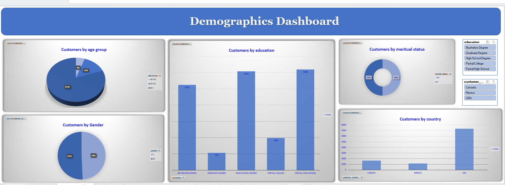
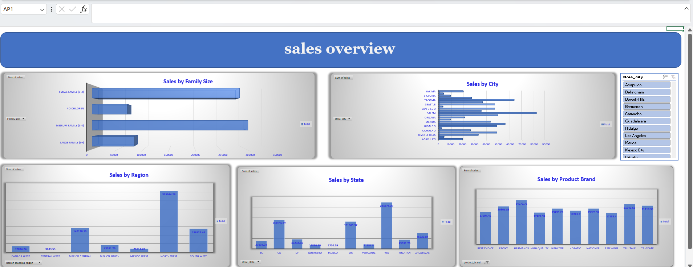

# Business Performance & Customer Analytics Dashboards

An interactive Excel project that turns raw retail sales data into three dashboards covering profit, customers, and sales across the USA, Canada, and Mexico.

## Project Overview

The dataset has more than 10,000 sales transactions linked to customer, product, store, and region tables. I cleaned the data, built Pivot Tables for the main KPIs, and designed three interactive dashboards with Slicers so anyone can filter by region, store, month, customer type, education, and country.

## Dashboards

### 1. Business Performance Dashboard
Monthly profit trend, profit by customer type, quantity sold by store, average income by region, and customers by income range.

### 2. Demographics Dashboard
Customer distribution by age group, gender, marital status, education, and country.

### 3. Sales Overview Dashboard
Sales by region, state, city, product brand, and family size.

### Pivot Tables (KPI Calculations)

## Key Insights

- Total sales were about 739K and total profit about 643K, across 10,281 transactions.
- The North West region had the highest sales (about 356K), and Washington (WA) was the top state (about 224K).
- Regular customers generated about 90% of the profit, compared to about 10% from Elite customers.
- Profit peaked in July (about 67K) and was lowest in January (about 29K).
- About 72% of customers are in the USA, and the largest income group is $30K–$50K.
- Medium-sized families (3–4 members) made the most sales.
- Store 17 sold the most units (764).

## Tools Used

- Microsoft Excel
- Pivot Tables and Pivot Charts
- Slicers
- Data Cleaning
- Dashboard Design

## Files

| File | Description |
|------|-------------|
| [Business_Performance_analytics.xlsx](Business_Performance%2c_analytics.xlsx) | Excel workbook with the dashboards and Pivot Tables |
| business performance.png | Business Performance dashboard screenshot |
| demographic.png | Demographics dashboard screenshot |
| sales.png | Sales Overview dashboard screenshot |
| pivot table.png | Pivot Tables sheet screenshot |

## Author

**Jana Ahmed Rashad**
Business Information Systems student | Aspiring Data Analyst
